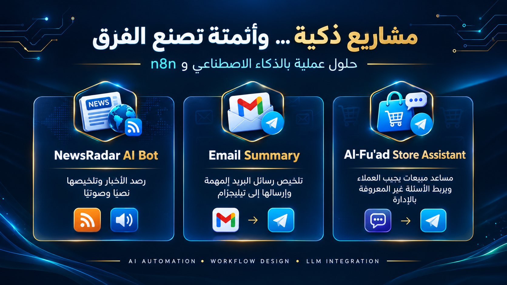

# 🤖 AI Automation Portfolio — Intelligent Workflows with n8n

A collection of practical **AI-powered automation projects** built with **n8n**, Large Language Models (LLMs), and third-party integrations. These projects demonstrate how intelligent workflows can automate repetitive tasks, simplify information management, improve customer communication, and deliver actionable insights through Telegram.

This portfolio includes three projects:

- 📰 **NewsRadar AI Bot** — Automated AI news monitoring, summarization, and audio digest.
- 📧 **Email Summary** — Intelligent email summarization and Telegram notifications.
- 🛍️ **Al-Fu'ad Store – Customer Response Bot** — An AI-powered store assistant for customer inquiries and sales support.

---

## 🖼️ Portfolio Overview



Explore the three automation workflows below to see how AI can be integrated into real-world applications.

---

# 📰 1. NewsRadar AI Bot — AI News Curator & Audio Digest

## 📌 Overview

NewsRadar AI Bot is an automated news aggregation and summarization workflow built with **n8n**. It collects news from RSS feeds and other configured sources, filters relevant updates, processes the collected information using **Google Gemini AI**, and delivers an organized Arabic news digest through Telegram.

The workflow also generates an audio version of the summary, allowing users to listen to important updates instead of reading the entire report.

## ✨ Key Features

- **Automated Scheduling:** Runs at configured intervals using Schedule Triggers.
- **RSS News Aggregation:** Collects news from multiple configured RSS feeds.
- **Smart Filtering:** Filters recent articles according to the configured time criteria.
- **AI-Powered Summarization:** Uses Google Gemini to summarize articles and highlight key information.
- **Arabic Content Generation:** Produces readable Arabic news summaries.
- **Text Notifications:** Sends formatted news digests to Telegram.
- **Audio Summaries:** Generates audio from the summary and sends it through Telegram.
- **Scalable Workflow:** Allows additional RSS sources and processing steps to be incorporated.

## ⚙️ Workflow Architecture

```text
[Schedule Triggers]
        |
        v
[RSS Feed Readers] ---> [Filters] --------+
        |                                  |
        +----------------------------------+
                                           |
[HTTP Request] ----------------------------+
                                           v
                                     [Aggregate]
                                           |
                                           v
                                  [Basic LLM Chain]
                                           |
                                    [Google Gemini]
                                           |
                          +----------------+----------------+
                          |                                 |
                          v                                 v
                 [Telegram Text]                    [Generate Audio]
                                                            |
                                                            v
                                                    [Telegram Audio]
```

## 🛠️ Technologies

- n8n
- Google Gemini AI
- RSS feeds
- Telegram Bot API
- HTTP Request integration
- OpenAI audio generation

## 🎯 Use Cases

- Monitoring artificial intelligence and technology news.
- Receiving daily news digests without manually browsing multiple websites.
- Listening to summarized updates while working or commuting.
- Automating the collection and distribution of relevant information.

---

# 📧 2. Email Summary — AI-Powered Email Digest

## 📌 Overview

Email Summary is an intelligent email automation workflow built with **n8n**, Gmail integration, and Google Gemini AI.

The workflow runs on a configured schedule, retrieves multiple email messages, processes their content through an LLM chain, and sends a concise summary to Telegram.

Its goal is to reduce the time spent reviewing email messages and help users identify important information more efficiently.

## ✨ Key Features

- **Scheduled Execution:** Automatically runs at configured times.
- **Gmail Integration:** Retrieves multiple email messages through the configured Gmail connection.
- **AI-Powered Summarization:** Processes email content using a Large Language Model.
- **Organized Information:** Condenses lengthy messages into a more manageable summary.
- **Telegram Delivery:** Sends the generated summary directly to a Telegram chat.
- **Reduced Manual Work:** Minimizes the need to open and review every email individually.
- **Extensible Design:** Can be adapted to support additional filtering, prioritization, and notification steps.

## ⚙️ Workflow Architecture

```text
[Schedule Trigger]
        |
        v
[Get Many Gmail Messages]
        |
        v
[Basic LLM Chain] <---- [Google Gemini Chat Model]
        |
        v
[Generate Email Summary]
        |
        v
[Telegram: Send Text Message]
```

## 🛠️ Technologies

- n8n
- Gmail integration
- Google Gemini Chat Model
- Large Language Models (LLMs)
- Telegram Bot API
- Schedule Trigger

## 🎯 Use Cases

- Summarizing email messages into a concise digest.
- Reviewing important correspondence more efficiently.
- Receiving email summaries through Telegram.
- Reducing repetitive email-reading tasks.
- Building a foundation for more advanced email management automation.

---

# 🛍️ 3. Al-Fu'ad Store — AI Customer Response Bot

## 📌 Overview

Al-Fu'ad Store – Customer Response Bot is an AI-powered customer support and sales assistant built with **n8n**, Telegram, and an AI chat model.

The workflow retrieves store information and clothing product data, aggregates the relevant information, and passes it to an AI assistant that responds to customer inquiries.

It also includes a separate administrative response workflow that helps route questions requiring human intervention to the store administrator.

## ✨ Key Features

- **Telegram Customer Support:** Receives customer messages through a Telegram bot.
- **Store Information Retrieval:** Retrieves configured store information.
- **Product Data Integration:** Retrieves and aggregates clothing product information.
- **AI-Powered Responses:** Uses an AI assistant to answer customer questions based on available store data.
- **Conversational Memory:** Uses a memory component to support conversational continuity.
- **Human-in-the-Loop Support:** Provides an administrative escalation path for questions requiring human input.
- **Administrator Notifications:** Routes relevant questions to the administrator through Telegram.
- **Customer Reply Delivery:** Sends the assistant's responses back to customers through Telegram.

## ⚙️ Workflow Architecture

### Customer Support Workflow

```text
[Telegram Trigger]
        |
        v
[Get Store Information]
        |
        v
[Aggregate Store Information]
        |
        v
[Get Clothing Products]
        |
        v
[Aggregate Product Data]
        |
        v
[Store Assistant]
        |
        +---- [OpenAI Chat Model]
        |
        +---- [Simple Memory]
        |
        +---- [Administrator Tool]
        |
        v
[Send Reply to Customer]
```

### Administrative Response Workflow

```text
[Admin Telegram Trigger]
        |
        v
[Extract Customer ID]
        |
        v
[Is Reply to Question?]
        |
        v
[Send Administrator Answer]
```

## 🛠️ Technologies

- n8n
- Telegram Bot API
- OpenAI Chat Model
- AI Agent / Store Assistant
- Conversational Memory
- Store and product data integrations
- Conditional workflow logic

## 🎯 Use Cases

- Answering common customer questions automatically.
- Providing information about available clothing products.
- Improving the responsiveness of an online store.
- Reducing repetitive customer support tasks.
- Escalating questions that require administrator involvement.
- Creating a foundation for more advanced AI-assisted sales workflows.

---

# 🧩 Shared Architecture & Design Principles

Although each project serves a different purpose, all three demonstrate practical automation principles.

| Principle | Implementation |
|---|---|
| Workflow Automation | n8n nodes and scheduled or event-driven triggers |
| AI Integration | LLM-powered summarization and conversational responses |
| Third-Party Integrations | Telegram, Gmail, RSS feeds, and AI services |
| Data Processing | Filtering, aggregation, and contextual information handling |
| Automated Delivery | Sending generated content and responses through Telegram |
| Extensibility | Modular workflows that can be adapted to additional requirements |

---

# 🛠️ Prerequisites

Requirements depend on the project you want to run.

### General Requirements

1. An active n8n instance, either cloud-hosted or self-hosted.
2. A Telegram bot and the appropriate chat IDs for Telegram-based notifications.
3. Valid credentials for the external services used by the selected workflow.

### Project-Specific Requirements

| Project | Main Requirements |
|---|---|
| NewsRadar AI Bot | n8n, RSS feeds, Google Gemini API credentials, Telegram credentials, and OpenAI credentials for audio generation |
| Email Summary | n8n, Gmail integration and authorization, a configured chat model, and Telegram credentials |
| Al-Fu'ad Store Bot | n8n, Telegram bot credentials, configured store and product data sources, an OpenAI chat model, and memory configuration |

**Important:** Credentials and external integrations must be configured according to the nodes included in each workflow. The exact setup may differ depending on the exported workflow version.

---

# ⚙️ Installation & Setup

## 1. Obtain the Workflow Files

Download or clone the repository containing the workflow JSON files.

```bash
git clone https://github.com/salman-dev-ai/n8n-ai-news-summarizer-telegram.git
```

The repository above is the NewsRadar project repository. The other workflows should be imported from their respective JSON files or repositories when available.

## 2. Import a Workflow into n8n

1. Open your n8n dashboard.
2. Create a new workflow or open the workflow import menu.
3. Select **Import from File**.
4. Choose the JSON file for the project you want to run.
5. Review the imported nodes and verify their connections.

## 3. Configure Credentials

Connect the required services for the selected workflow:

- Telegram bot credentials and destination chat IDs.
- Google Gemini API credentials, where required.
- OpenAI credentials, where required.
- Gmail authorization for Email Summary.
- Store and product data sources for Al-Fu'ad Store.

## 4. Review Workflow Settings

- Verify trigger schedules and execution intervals.
- Check RSS feed URLs and filtering conditions for NewsRadar.
- Review the Gmail retrieval settings for Email Summary.
- Verify store data retrieval, product information, and administrator routing for Al-Fu'ad Store.
- Ensure that Telegram destinations and message mappings are correct.

## 5. Test and Activate

1. Execute the workflow manually to test its behavior.
2. Review node outputs and execution logs.
3. Resolve any missing credentials or configuration errors.
4. Save the workflow.
5. Activate or publish it when all required settings have been verified.

---

# 🔐 Security & Best Practices

- Store API keys and bot tokens in n8n credentials rather than hardcoding secrets.
- Never commit passwords, access tokens, or private API keys to GitHub.
- Verify the permissions granted to Gmail and other connected services.
- Validate external data before passing it into AI prompts.
- Test workflows with representative inputs before enabling scheduled execution.
- Review AI-generated content before using it for critical decisions.
- Protect customer information and restrict access to administrative workflows.

---

# 👨‍💻 Author

**Salman Al-Ansi**

- **Portfolio:** [salman-al-ansi.vercel.app](https://portfolio-en-salman-32c9.vercel.app/)
- **GitHub:** [salman-dev-ai](https://github.com/salman-dev-ai)
- **NewsRadar Repository:** [n8n-ai-news-summarizer-telegram](https://github.com/salman-dev-ai/n8n-ai-news-summarizer-telegram)

---

# 🌟 Final Thoughts

These three projects demonstrate how AI and workflow automation can be applied to different real-world challenges:

- 📰 **NewsRadar AI Bot:** Turns multiple news sources into an accessible text and audio digest.
- 📧 **Email Summary:** Makes email review more efficient through automated summarization.
- 🛍️ **Al-Fu'ad Store Assistant:** Supports customer communication through AI-powered responses and administrative escalation.

Together, they represent a practical approach to combining **AI, automation, integrations, and intelligent information processing** to build useful digital solutions.

*Building practical AI solutions, one workflow at a time.*

#AI #ArtificialIntelligence #n8n #Automation #WorkflowAutomation #GoogleGemini #OpenAI #TelegramBot #GmailIntegration #LLM
